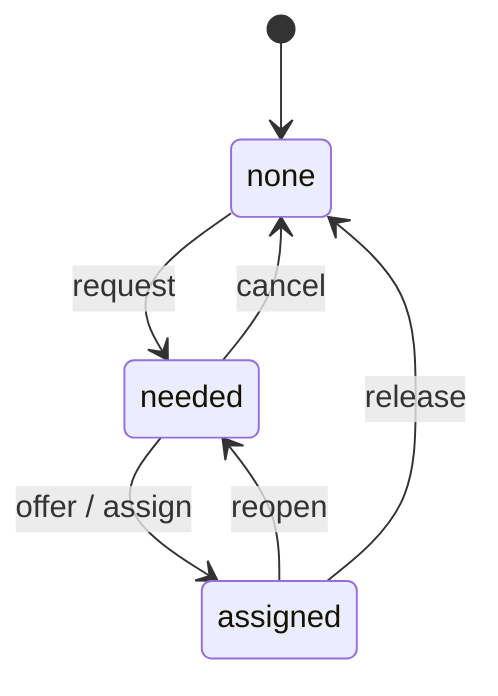

# Backup workflow design

This document records how shift coverage ("Need backup") works: the states, who may do
what, how it is stored, and how it appears on the schedule. It matches the code as of
November 8, 2026. When behavior changes, update this file together with the code and tests.

Code map:

| Concern | Where |
| --- | --- |
| Rules, permissions, storage | `saveBackup`, `backupState`, `isManager`, `isPrimary` in `server/api.mjs` |
| Shift card, buttons, forms | `renderScheduledShift` and `renderShift` in `index.html` |
| Past-shift display | `loadHistory` in `index.html` |
| Storage table | `shift_backups` in `migrations/0001_shared_storage.sql` |
| Tests | `tests/api.test.mjs` (rules), `tests/ui.test.mjs` (card and history) |

## Terms

- **Shift**: one service date plus Morning (`am`) or Evening (`pm`).
- **Primaries**: the volunteers assigned to that weekday and shift in the recurring schedule.
  They are derived, never stored per day. A shift can have several primaries or none.
- **Manager**: a super-admin, admin, or coordinator.
- **Backup**: the one volunteer currently covering a shift whose primaries are unavailable.
- **Requester**: the person who pressed Need backup.

## Principles

1. Primaries always stay on the card, even while a backup covers.
2. A request marks all primaries on the shift unavailable, even if only one of them asked.
3. The Backup slot has one current state. No backup history is kept, by design.
4. The server enforces every rule. Hiding a button is only a convenience.
5. Backup actions apply to today and the next six days only. Earlier dates are read-only.

## States



| State | Meaning | Primaries |
| --- | --- | --- |
| `none` | No request. Also the state after cancel or release. | Active |
| `needed` | A request is open and the Backup slot is empty. | All unavailable |
| `assigned` | A volunteer is covering. | All unavailable |

## Actions

| Action | Button label | Moves | Who may do it |
| --- | --- | --- | --- |
| `request` | Need backup (icon) | none to needed | A primary of that shift, or a manager |
| `offer` | Offer to cover | needed to assigned | Any signed-in active volunteer who is not a primary of that shift. The volunteer becomes the backup |
| `assign` | Assign (with a volunteer dropdown) | needed to assigned | A manager. The chosen volunteer must be active and not a primary of that shift |
| `reopen` | Need backup | assigned to needed | The current backup, or a manager. The slot empties and someone else can take it |
| `cancel` | Cancel need for backup | needed to none | A primary of that shift, or a manager |
| `release` | Release backup | assigned to none | A primary of that shift, or a manager. Primaries are active again |

Rules that follow from this:

- The backup has no cancel or undo after `reopen`. Anyone may offer again.
- `cancel` only applies while the slot is needed. `release` only applies while assigned.
- `assign` only works from `needed`. To replace an assigned backup, a manager uses `reopen`
  and then `assign`.
- A manager who is also a primary of the shift may request, cancel, and release, but cannot
  offer or be assigned as that shift's backup.
- `requestedBy` and `notes` come from the original request and are kept when the slot is
  reopened or filled again.

## Permission and error order

`saveBackup` checks, in order: the date window (400), valid shift and action (400), valid
version (400), the version against the stored row (409), then the action rules. For
`request`, `reopen`, `cancel`, and `release` the permission check (403) comes before the
state check (409). For `offer` and `assign` the state check (409) comes after the permission
check. Signed-out requests get 401 before any of this.

| Status | Typical reason |
| --- | --- |
| 400 | Date outside today to +6 days, bad input, assigning an unavailable or primary volunteer |
| 401 | Not signed in |
| 403 | Not allowed to do this action |
| 409 | Version is stale, or the shift is not in the state this action needs |

## Concurrency

Each shift row has a `version`. The client sends the version it last saw (0 if none). The
update only succeeds when the version still matches (`UPDATE ... WHERE version = ?`, or
`INSERT OR IGNORE` for a first row). If two people act at once, one succeeds and the other
gets 409. On 409 the card re-syncs and shows the message "The latest status is shown above."

## Storage

Table `shift_backups` (primary key `service_date` + `shift`): `state_json`, `version`,
`updated_at`. No migration was needed for this workflow because the state is JSON.

Current `state_json` shapes:

```json
{ "status": "none" }
```

```json
{
  "status": "needed",
  "requestedBy": { "id": "swetha", "name": "Swetha Mtj" },
  "requestedAt": "2026-11-08T20:00:00.000Z",
  "notes": "Travelling",
  "backup": null
}
```

```json
{
  "status": "assigned",
  "requestedBy": { "id": "swetha", "name": "Swetha Mtj" },
  "requestedAt": "2026-11-08T20:00:00.000Z",
  "notes": "Travelling",
  "backup": { "id": "hema", "name": "Hema Mtj" },
  "assignedAt": "2026-11-08T21:00:00.000Z",
  "assignedBy": "hema"
}
```

Cancel and release store `{ "status": "none" }` and keep the row so the version keeps
counting up.

Older records used `person`, `cover`, `coveredBy`, `wasBackup`, and `history`. `backupState`
maps them when read: a record with `cover` is `assigned`, otherwise `needed`, and `history`
is dropped. They are rewritten in the new shape on the next action.

## API

`POST /api/backups` (signed in, same-origin):

```json
{ "date": "2026-11-08", "shift": "am", "action": "request", "version": 0,
  "notes": "optional", "volunteerId": "only for assign" }
```

Response: `{ "state": { ...new state, "version": n } }`.

`GET /api/schedule?from=...&to=...` returns `backups` keyed by `"date:shift"`, each with the
current state and its `version`. A missing key means no request was ever made.

## What the card shows

Signed-out visitors and past dates see the state but no buttons.

| State | Card | Lines | Buttons (signed in) |
| --- | --- | --- | --- |
| `none` | Normal | Primary names | Need backup icon (primary or manager) |
| `needed` | Pink | Primary names struck through, `Backup  Needed`, `Requested by ...`, note | Offer to cover (not primaries), Cancel need for backup (primary or manager), Assign dropdown (manager) |
| `assigned` | Green | Primary names struck through, `Backup  <name>`, `Requested by ...`, note | Need backup (current backup or manager), Release backup (primary or manager) |

Copy decisions: no "Unavailable" label, no "Backup confirmed" or "Backup needed" banner (the
card color and the Backup line say it), and no email address on shift cards (the contact
icon menu remains). Shifts with no primaries and no request show the existing
"Needs a volunteer" text.

While someone has the request form open or has chosen a volunteer in the Assign dropdown,
background refreshes skip that card so their input is not lost.

## Past shifts (History)

History is read-only and for signed-in volunteers. For each past shift:

- If the final state is `assigned`: show the primaries struck through and the line
  `Backup: <name> covered this shift.` plus the request note.
- Otherwise (`none`, or `needed` that was never filled): show only the primaries.

Past primaries come from `schedule_versions`, not from today's volunteer records.

## Edge cases

- **Primaries are live**: for today and future dates the primaries come from the current
  recurring schedule. If an administrator edits the recurring schedule while a request is
  open, the card shows the new primaries.
- **No primaries**: only a manager can request, and the card shows the empty primary line.
- **Deactivated volunteers**: they cannot sign in, and cannot be assigned. A name already
  stored in a request stays as written.
- **Name changes**: `requestedBy.name` and `backup.name` are snapshots. Contact icons match
  by id where available, and are omitted for ambiguous names.
- **Day rollover**: a shift older than today can no longer change, whatever its state.

## Out of scope

- Backup history or an audit trail.
- WhatsApp or other notifications (discussed, not built; see `PROJECT_MEMORY.md`).
- Automatic assignment of the permanent backups listed on the Schedule tab.
- Partial cover, where only one of several primaries is unavailable.
