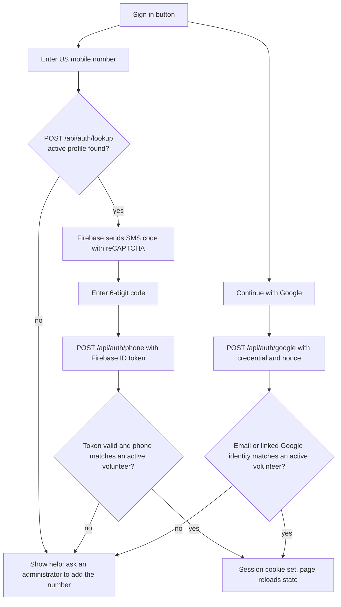

# Temple Services: workflows and logic

This is the design record for the whole website: who can do what, how each workflow behaves,
and where the logic lives. It matches the code as of November 8, 2026. Anyone changing
behavior (people or AI tools) should read the relevant section first and update this file,
the tests, and `AGENTS.md` in the same change.

The backup workflow is large enough to have its own document:
[backup-workflow.md](backup-workflow.md).

## 1. Purpose

Volunteers do laundry seva for Sri Radha Kalachandji Temple in Morning and Evening shifts.
The site lets everyone see who is on each shift, lets volunteers report what they completed,
arranges cover when someone cannot serve, and lets coordinators manage the recurring weekly
plan and the volunteer directory.

Not built (do not assume these exist): volunteer-entered planned absences or multi-week
absence requests, a "mark my work done" button separate from notes, WhatsApp posting or share
buttons, automatic assignment of permanent backups, and automatic data retention or deletion.

## 2. Architecture

| Piece | Details |
| --- | --- |
| Front end | Static files: `index.html` (page script and styles), `volunteers.js`, `recurring.js`, `phone-auth.js`. No framework, no build step beyond copying files (`scripts/build.mjs` to `dist/`) |
| API | One Cloudflare Pages Function, `functions/api/[[path]].js`, which calls `handleApi` in `server/api.mjs` (notes, schedule, backups). It delegates sign-in, the directory and the recurring schedule to `handlePeople` in `server/volunteers.mjs` |
| Data | Cloudflare D1 binding `DB` (all records) and private R2 binding `PHOTOS` (photo files). Photos are served only through the API |
| Hosting | Cloudflare Pages project `templeservices`; pushing `main` deploys automatically |
| Sign-in | Google, US mobile phone via Firebase Authentication, and email codes through Resend when configured |
| Tests | `node --test tests/*.test.mjs` (Node 24+ recommended). A fake DOM in `tests/ui.test.mjs` runs the page script |

Conventions that hold everywhere:

- **Time zone**: service dates are America/Chicago. The server uses `today()` in `server/api.mjs`
  and the page uses `templeToday()`. Never use the browser's local date for service dates.
- **Shifts** are `am` (Morning) and `pm` (Evening). Weekdays are numbered Monday 0 to Sunday 6.
- **Optimistic concurrency**: records that several people can edit carry a `version`. Writes
  succeed only if the version still matches, otherwise the API returns 409.
- **Server enforces everything**. Hidden buttons are convenience only.
- **Same-origin writes**: every POST must send an `Origin` header equal to the site's origin.
- **Errors**: the API returns `{ "error": "message" }`. Messages are written for volunteers.
- **Copy**: keep interface text short. The owner repeatedly removed explanatory filler.

## 3. Roles and permissions

Roles live on each volunteer: `super-admin`, `admin`, `headpujari`, `coordinator`,
`volunteer`, `backup`, `other`. Only `super-admin`, `admin` and `coordinator` carry extra
permissions. `headpujari`, `backup` and `other` are labels (the `backup` label lists a person
under "Permanent backups").

| Capability | Signed out | Signed-in volunteer | Primary of that shift | Coordinator | Admin | Super-admin |
| --- | --- | --- | --- | --- | --- | --- |
| View schedule (yesterday to six days ahead), instructions, directory | Yes | Yes | Yes | Yes | Yes | Yes |
| See phone and email of volunteers | No | Yes | Yes | Yes | Yes | Yes |
| View past shifts and past photos | No | Yes | Yes | Yes | Yes | Yes |
| Add, edit, delete own notes (yesterday and today) | No | Yes | Yes | Yes | Yes | Yes |
| Offer to cover a shift needing backup | No | Yes (not if primary) | No | Yes | Yes | Yes |
| Need backup, cancel need, release backup | No | No | That shift only | Any shift | Any shift | Any shift |
| Assign a backup, reopen a backup slot | No | No | No | Yes | Yes | Yes |
| Edit the recurring weekly schedule | No | No | No | Yes | Yes | Yes |
| Add, edit, deactivate volunteers | No | No | No | No | Yes | Yes |
| Edit the super-admin record | No | No | No | No | No | Yes |
| See inactive volunteers | No | No | No | No | Yes | Yes |

Signing in does not let a volunteer edit their own profile or recurring assignments.

## 4. Sign-in and sessions

Only people with an **active volunteer profile** can sign in. Having a name on the schedule
does not create a login.

- **Phone**: the page only accepts US mobile numbers (`normalizePhone` in `server/firebase.mjs`
  stores `+1XXXXXXXXXX`). The server verifies the Firebase token: signature, project, issuer,
  expiry, phone provider, and a sign-in within the last 5 minutes. SMS region policy is US only
  in Firebase; never rely on the `+1` prefix alone.
- **Google**: uses a nonce cookie and server-side verification. A first successful sign-in links
  the Google subject to the volunteer found by email. It never creates a volunteer.
- **Email codes**: the server endpoints exist and work only when `RESEND_API_KEY` and `EMAIL_FROM` are
  configured, but the current page offers only phone and Google, and its email form stays hidden. Codes are salted, hashed, expire in 10 minutes, allow 5 attempts, and are rate
  limited per email, per IP and per day.
- **Sessions**: a random token is stored as a SHA-256 hash in `auth_sessions`; the browser holds an
  `HttpOnly`, `Secure`, `SameSite=Lax` cookie `tls_session` for 30 days. Sign out deletes the
  session. `GET /api/auth/me` returns the current user or null.
- **Revocation**: changing a volunteer's email or phone, or deactivating them, deletes their
  sessions, linked identities and pending email codes. Inactive volunteers cannot use a session.
- **Rate limits**: sign-in endpoints are limited per IP per hour (`limitAuth`).
- Secrets and the Firebase setup are described in `README.md`. Never store tokens or keys in the
  repository, logs or chat output.

## 5. Schedule view and live updates

The Schedule tab shows **eight days**: yesterday, today, and the next six. Each day has a
Morning and an Evening card. The three main tabs (Schedule, Instructions, Volunteers) follow the
ARIA tabs pattern with arrow, Home and End keys.

- Names come from the volunteer directory: a volunteer appears on a shift when their
  `assignments` include that weekday and shift. `WEEKLY_PLAN` in `index.html` is only a fallback
  until the directory loads.
- `GET /api/schedule?from&to` returns, for at most eight days: assignments per day and shift,
  notes with photos, and backup states. Dates before yesterday require sign-in.
- The page refreshes every 30 seconds while visible, and again when the tab becomes visible. A new
  day triggers a full re-render. Open forms and typed drafts are never overwritten by a refresh.
- Static, code-edited content in `index.html`: `INSTRUCTIONS` (the Instructions tab, one entry per
  topic, empty body shows "Instructions coming soon."), `ABSENCES` (planned absences, see below)
  and `BACKUPS` (fallback list only). Edit these in code; there is no admin screen for them.
- **Planned absences** (`ABSENCES`) is a static array. A matching person on a shift shows struck
  through with an "Away" chip, and any listed `cover` name is shown. It is separate from the
  backup workflow, and nothing in the site writes to it.
- **Permanent backups** appear under the schedule: every active volunteer with the `backup` role,
  with contact icons for signed-in users. They are a reference list; nothing assigns them
  automatically.

## 6. Notes, checklists and photos (load updates)

Each shift card has a pencil button for signed-in volunteers on **yesterday and today only**.

- An entry has: a checklist for three loads (Kitchen, Pujari, Deity) by three stages (Washed,
  Dried, Folded), an optional note up to 1,000 characters, and up to 4 photos.
- An entry must contain at least one checked item, a note, or a photo.
- **One live entry per volunteer, date and shift.** Others can add their own entries to the same
  shift. The button becomes Edit Notes once you have saved.
- **Author only**: only the author can edit or delete an entry, checked by volunteer id (never by
  display name). Administrators cannot edit someone else's notes.
- The author's name is stored with the entry at save time.
- **Editing safety**: each entry has a `version` and each edit an `operationId`. A retry of the same
  operation returns success without duplicating; a stale version returns 409. While editing, the
  saved preview of that entry is hidden so it is not shown twice.
- **Photos**: the page downsizes a photo to at most 800 px JPEG (quality 0.7). The server accepts
  JPEG only, up to 1 MB each. Files are stored in R2 under unique keys; only the keys are in D1.
  Retained photos must belong to the entry being edited. Failed saves delete uploaded files, and
  removed photos are deleted after a successful save.
- **Delete is soft** (`deleted_at`). The entry and its photos disappear from the site and the
  author can add a new one. Nothing is permanently purged.
- **Reading**: yesterday's and today's entries and photos are public. Older ones need sign-in.
- Endpoints: `POST /api/updates` (create or edit), `POST /api/updates/delete`,
  `GET /api/photos/<key>`.

## 7. Backup workflow

Summarized here, fully specified in [backup-workflow.md](backup-workflow.md):

- A shift's **primaries** are its recurring assignees and always stay on the card.
- **Need backup** (a primary or a manager) marks all primaries unavailable and opens one Backup
  slot. Volunteers **offer to cover**, or a manager **assigns** someone.
- The backup can reopen the slot; **cancel need for backup** and **release backup** return the
  shift to normal. Only the current state is stored (`shift_backups`), no history.
- Available for today and the next six days. All permissions are enforced by `saveBackup`.

## 8. Recurring weekly schedule

The recurring plan is the set of `assignments` (weekday plus shift) on each active volunteer. It
is displayed as a compact Monday to Sunday table below Permanent backups.

- **Who can edit**: coordinators, admins and the super-admin see one **Edit recurring schedule**
  button. Everyone else sees the table read-only.
- **Editing**: each of the 14 shifts has a multi-person checkbox picker listing only active
  volunteers. A shift may be empty or have several people. Nothing is saved until **Save recurring
  schedule**; **Cancel** discards the draft.
- **Atomic save**: `POST /api/recurring/save` sends every active volunteer's id, version and
  assignments. One guarded SQL statement updates all of them, and rejects the whole save (409) if
  any volunteer or version changed, or if the volunteer list changed. It updates assignments only,
  never contact details or roles. Coordinators do not gain profile editing or private data.
- **Effect on dates**: changes apply to today and future dates. Past dates keep the plan that was
  in force (see section 10).

### Planned dates (dated primaries)

A **dated plan** sets the primaries for one shift on one date. It replaces the weekly primaries
for that shift and date only; every other date follows the weekly plan.

- **Rule**: for each date and shift, use the dated plan if one exists, otherwise the weekly plan.
  `readSchedule` applies it, so schedule cards, history and the client all see the same primaries.
  `isPrimaryOn` applies it to backup permissions (a weekly person is not a primary on a replaced
  date, and a planned person is).
- **Replace, not add/remove**: a dated plan is the full list of primaries. An empty list is a valid
  explicit "no one planned" date.
- **Who and when**: coordinators, admins and the super-admin only. Dates run from today up to 90
  days ahead, at most 30 dates per save. Volunteers must be active.
- **UI**: the "Planned dates" list sits under the weekly table (visible to everyone, with the weekly
  names for comparison). Managers get **Plan dates** (shift, dates added one by one or repeated
  weekly for 2 to 12 weeks, volunteers), and **Edit** and **Remove** on each row. Managers also see
  a "Planned date" tag on shift cards.
- **API**: `GET /api/planned` (upcoming plans), `POST /api/planned/save`
  `{shift, dates[], volunteerIds[]}` (upsert for each date, atomic), `POST /api/planned/remove`
  `{shift, date}`. `GET /api/schedule` adds `planned` (`"date:shift": true`) for managers only.
- **Open backup requests**: saving or removing a plan for a date whose backup is `needed` or
  `assigned` is rejected (409). Cancel or release the request first.
- **Storage**: table `planned_shifts` (migration 0007), one row per date and shift with
  `people_json` snapshots. Rows are never deleted by the app except through Remove, so history keeps
  them. For today and future dates names are read live and deactivated volunteers are dropped; for
  past dates the stored snapshot is shown.
- **Before the migration is applied**, the API treats the table as empty so the site keeps working.

## 9. Volunteer directory (profiles)

The Volunteers tab lists active volunteers as wide row cards: name and roles, recurring service
days, and availability notes. Controls above the list filter by search text (name and availability),
role and service day, and sort by name A to Z, Z to A, or number of recurring shifts. A count shows
matches, with a friendly empty state.

- **Visible to everyone**: name, roles, recurring assignments, availability notes (active people
  only). **Visible to signed-in volunteers**: phone and email.
- **Admins and the super-admin** can Add volunteer, Edit volunteer and Remove (deactivate) a
  volunteer. Removal sets `active = 0`; records are never hard-deleted, so history stays intact.
  Admins also see inactive volunteers.
- Validation in `saveVolunteer`: valid roles with no duplicates; a valid US phone if given; a valid
  email if given; unique email and unique phone; at most 14 recurring assignments with no repeats;
  `version` must match (409 otherwise).
- **Protections**: the `super-admin` role cannot be granted to others or removed, and that record
  must stay active and keep the role. Only the super-admin can edit it. An admin cannot remove their
  own admin role or deactivate themselves. Administrators need a sign-in email or a phone number
  while phone sign-in is configured. Nanda Kumar Das is the protected super-admin.
- **Names**: women's display names end in `Mtj`; Ajinkya's is `Ajinkya Pr`; Nanda Kumar Das is
  unchanged. Do not "correct" these or reseed them from old rosters. The live D1 data is
  authoritative and is edited through the website.

## 10. Past shifts (history)

Signed-in volunteers get **View past shifts**: a date picker plus previous and next week buttons,
read-only. It shows, for each past shift, the primaries, a backup only if one was assigned,
notes with checklists and photos. Signing out clears it.

- **Why past names are correct**: the table `schedule_versions` stores the full recurring plan
  (names, ids, assignments). Database triggers record a new version whenever a volunteer is
  inserted, deleted, or has name, assignments or active status changed. For a past date the plan is
  the latest version recorded before the end of that day (Chicago time, including daylight saving).
  Today and future dates use the current plan.
- Dates before the first recorded version show "Original assignment not recorded." Never guess
  historical names from today's roster.
- Notes older than yesterday cannot be saved or deleted. There is no correction workflow.

## 11. Volunteer contact links

Signed-in users see a contact icon beside volunteer names. It opens a small menu with Call, SMS and
WhatsApp (`wa.me`, international digits; availability of a WhatsApp account is not verified). The
email address is not shown on shift cards (it still appears in places such as directory profiles).

- Contact details never appear for anonymous visitors, inactive volunteers, dates before today, or
  anywhere in history.
- Contacts match by volunteer id where available. Ambiguous name matches show no contact.
- The menu closes on outside click, Escape, focus leaving, scrolling and sign-out.

## 12. Data model (D1)

| Table | Purpose |
| --- | --- |
| `volunteers` | People: name, email, phone, roles, assignments, availability, active, super-admin flag, version |
| `auth_sessions`, `auth_identities`, `email_codes`, `auth_rate_limits` | Sessions, linked Google identities, email codes, limits |
| `load_updates`, `update_photos` | Shift notes, checklists, photo keys (soft delete, versions, operation ids) |
| `shift_backups` | One row per date and shift: current backup state and version |
| `schedule_versions` | Recorded recurring plans for historical lookups (trigger-maintained) |
| `planned_shifts` | Dated primaries that replace the weekly plan for one shift on one date |

Migrations (`migrations/0001` to `0006`) are already applied in production, some by direct
`wrangler d1 execute`, so there is no reliable migrations tracking table. **Never reapply them**.
Inspect the real schema first and add a new forward migration (`0007_...`) for any change. The
seed in `0002` must never be run against live data.

## 13. Hosting, configuration and testing

- Cloudflare Pages deploys `main`. Branch pushes can create preview deployments that may not have
  the same bindings, so verify on production only after merging.
- `wrangler.toml` declares the Pages output, the D1 and R2 bindings, and the public Firebase web
  config. Secrets (`RESEND_API_KEY`, `GOOGLE_CLIENT_ID`, etc.) live in Pages settings, never in the
  repository.
- Run `node --test tests/*.test.mjs` and `node scripts/build.mjs` before pushing. A server-side
  compile check is `npx --offline wrangler pages functions build functions --outdir .wrangler/verify`.
- Where behavior is tested: rules in `tests/api.test.mjs`, `tests/volunteers.test.mjs`,
  `tests/history.test.mjs`, `tests/notes.test.mjs`, `tests/recurring.test.mjs`,
  `tests/firebase.test.mjs`; page behavior in `tests/ui.test.mjs`.

## 14. Changing a workflow: checklist

1. Read the section above and the code named in it.
2. Change the server first, since it is the source of truth for permissions.
3. Update the page and keep button visibility consistent with the server.
4. Update or add tests for every new rule and every new permission.
5. Update this document (and `backup-workflow.md` if it is about backup) and `AGENTS.md` if the
   guidance for future tools changes.
6. Avoid schema changes unless necessary; if needed, write a new migration and say so clearly.
7. Report accurately whether work was only prepared locally, pushed, or deployed.
